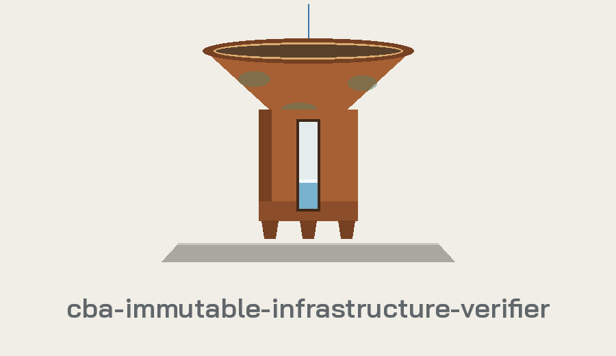

# cba-Immutable-Infrastructure-Verifier

Validates that a system's configuration matches its declared immutable infrastructure definition (e.g., defined in Terraform or Ansible). Verifies the presence and integrity of specific files, services, and configurations defined in the infrastructure as code, ensuring that the system hasn't deviated from its intended state and alerting on any inconsistencies. - Focused on Compares system configurations (e.g., application settings, firewall rules expressed in YAML/JSON) against predefined security baselines. Identifies deviations from the approved configuration and reports potential vulnerabilities or misconfigurations. Aims to automate the process of ensuring consistent security hardening across environments.

A definition with no files and no services entries is a configuration error and exits 2, because nothing was checked. A passing run reports how many checks it performed.

> **Shelter notice: no files, no services, exit 2.** A definition with no files and no services entries is a configuration error and exits 2, because nothing was checked.

> **Shelter notice: three posts carry no description.** `--definition`, `--type`, and `--schema` are each listed with no description provided. This document does not guess which file `--definition` points to, what values `--type` takes, or what `--schema` validates against.

## Install
`git clone https://github.com/ShadowStrikeHQ/cba-immutable-infrastructure-verifier`

## Usage
`./cba-immutable-infrastructure-verifier [params]`

## Parameters
- `-h`: Show help message and exit
- `--definition`: No description provided
- `--type`: No description provided
- `--verbose`: Enable verbose output for debugging
- `--schema`: No description provided

## License
Copyright (c) ShadowStrikeHQ
